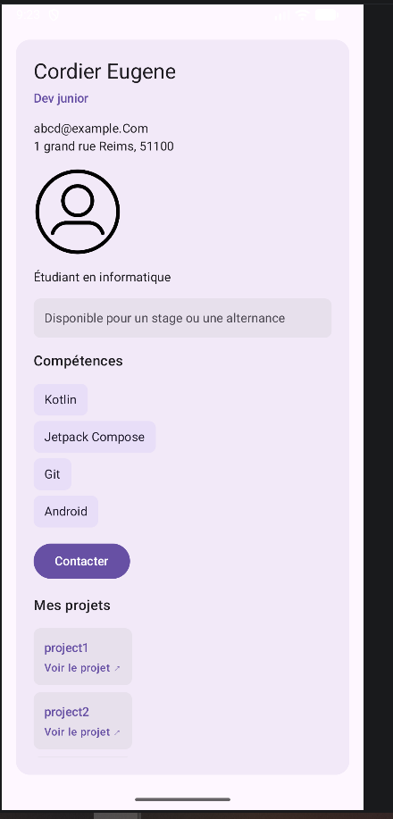

# Devoir – Amélioration UI de l’application « Profil développeur »

## Description

Application Android réalisée avec Jetpack Compose. Elle affiche la fiche de profil d'un développeur junior : nom, métier, avatar, coordonnées (email, téléphone, adresse), description, liste de compétences et liste de projets.

Le bouton Contacter ouvre l'application Téléphone avec le numéro pré-rempli, et chaque projet ouvre son lien dans le navigateur. Toutes les données sont locales et écrites directement dans le code Kotlin.

## Capture d'écran

## Composants Compose utilisés

- `Text` : nom, métier, description, titres de section, informations de contact, libellés
- `Button` : action principale « Contacter »
- `Icon` : icônes devant l'email, le téléphone et l'adresse
- `Image` : avatar du développeur (`painterResource`, `ContentScale.Crop`)
- `Surface` : carte du profil, puces de compétences, bloc de disponibilité, cartes de projets
- `Scaffold` : structure de l'écran et gestion des marges système (`innerPadding`)
- `MaterialTheme` : thème de l'application (couleurs, typographie, formes)

Composables personnalisés et réutilisables : `ProfileScreen`, `ProfileCard`, `ProfileHeader`, `ContactInfo`, `SkillItem`, `AvailabilityInfo`, `ProfileActions`, `ProjectItem`.

## Layouts utilisés

- `Column` : organisation verticale de l'écran et de chaque carte
- `Row` : avatar à gauche et coordonnées à droite ; icône et texte sur une même ligne ; bouton d'action
- `Spacer` : espace entre le nom et le métier
- `Surface` : zones visuelles cohérentes avec le thème
- `Modifier` : `padding`, `size`, `fillMaxWidth`, `weight`, `clickable`
- `Arrangement.spacedBy` et `Alignment` : espacement et alignement des éléments

## Listes avec `LazyColumn`

L'application affiche deux listes avec `LazyColumn` :

- Compétences : chaque élément de la liste `skills` est affiché avec le composable réutilisable `SkillItem`, une puce colorée avec la couleur `secondaryContainer`.
- Projets : chaque `Project` (titre et lien) de la liste `projects` est affiché avec `ProjectItem`. Un clic sur la carte ouvre l'URL grâce à `LocalUriHandler`.

`LazyColumn` ne compose que les éléments visibles à l'écran. C'est donc plus adapté qu'une `Column` classique dès que la liste peut grandir. Les données viennent de `listOf(...)` et d'une `data class Project(title, url)`, sans API ni base de données. `verticalArrangement = Arrangement.spacedBy(...)` gère l'espacement entre les éléments.

## Choix de thème

Le thème `DeveloppeurProfilTheme` est défini dans `ui/theme/Theme.kt` et s'appuie sur Material Design 3 :

- **Couleurs (`colorScheme`)** : une palette bleu indigo, avec un `lightColorScheme` pour le thème clair et un `darkColorScheme` pour le thème sombre. Le thème suit automatiquement le réglage du téléphone grâce à `isSystemInDarkTheme()`.
- **Couleurs dynamiques désactivées** (`dynamicColor = false`) : sinon, sur Android 12 et plus, le système remplace la palette par celle du fond d'écran. Désactivées, elles garantissent une identité visuelle identique sur tous les appareils.
- **Typographie (`typography`)** : styles personnalisés pour les titres (`headlineSmall`, `titleMedium`, `titleSmall`) et le texte courant (`bodyMedium`), pour une hiérarchie claire entre nom, sections et contenu.
- **Formes (`shapes`)** : coins arrondis définis une seule fois (`small`, `medium`, `large`) puis réutilisés via `MaterialTheme.shapes`, pour une interface cohérente.
- **Aucune couleur écrite en dur dans les composables** : tout passe par `MaterialTheme.colorScheme`, ce qui permet au changement clair/sombre de s'appliquer partout.

## Previews

Le projet contient plusieurs `@Preview` :

- `PreviewProfilAndroidJunior` : profil d'une développeuse Android junior, disponible
- `PreviewProfilFullStack` : profil d'un développeur full-stack, non disponible

## Quelles notions du chapitre Compose UI avez-vous réutilisées dans cette application ?

J'ai réutilisé les composants de base (`Text`, `Button`, `Icon`, `Image`, `Surface`), les layouts (`Column`, `Row`, `Spacer`, `Scaffold`) et les `Modifier`. J'ai aussi utilisé les composants listes avec `LazyColumn` et mes composants réutilisables (`SkillItem`, `ProjectItem`). J'ai utilisé Material Design 3 avec un thème personnalisé (`colorScheme`, `typography`, `shapes`) en clair et en sombre.
J'ai ppris comment ouvrir une application tierce (appel téléphone) et les liens cliquables.
